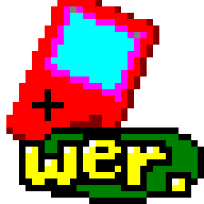

# wer



A Game Boy, Super Game Boy and Game Boy Color emulator written in
[C3](https://c3-lang.org), with SDL3 for video, sound and input.

It aims at accuracy: the CPU, timer, PPU and APU are modelled at the level
the common hardware test suites check ([results](docs/FEATURES.md#test-results)).

**Play it in your browser:** https://8lall0.github.io/wer/ (bring your own
ROMs: they never leave the browser; touch controls on phones).

## Highlights

- Every Game Boy: DMG, Pocket, Super Game Boy 1 and 2, Game Boy Color in
  each chip revision, and a Game Boy Advance running Game Boy games.
- Accurate: every test of Mooneye, Mealybug Tearoom, Blargg, SameSuite,
  Gambatte, AGE and more passes ([results](docs/FEATURES.md#test-results)).
- Nearly every cartridge: all of Nintendo's mappers with their clocks,
  rumble, tilt and the Game Boy Camera (through your webcam), the Nintendo
  Power GB Memory, and the unlicensed and bootleg boards.
- The link cable and its accessories: two or four Game Boys in one window or
  over the network, the Printer, the Mobile Adapter GB back online, card
  readers, infrared toys and more ([accessories](docs/ACCESSORIES.md)).
- Save states, rewind, fast forward, cheats, IPS/UPS/BPS patches, GIF and
  WAV recording, movies, a debugger; on Linux, Windows, macOS, Android and
  in the browser. Its own boot ROMs: no Nintendo code.

The whole list is in [docs/FEATURES.md](docs/FEATURES.md).

## Getting it

Linux, Windows, macOS and web builds are on the
[releases page](https://github.com/8lall0/wer/releases). To build it, with
[c3c](https://github.com/c3lang/c3c) 0.8.x and SDL 3.2 or newer:

```sh
c3c build -O3        # build/wer
```

The other platforms, the tests and the source layout are in
[docs/DEVELOPMENT.md](docs/DEVELOPMENT.md).

## Running

```sh
wer game.gb                 # or start without a ROM and open one from the menu
wer --mode=cgb game.gbc
```

Esc opens the menu; arrows, Z and X play. Every option, key and the
debugger are in [docs/USAGE.md](docs/USAGE.md).

## Documentation

| | |
|---|---|
| [Features](docs/FEATURES.md) | what wer emulates, and its test results |
| [Using wer](docs/USAGE.md) | command-line options, controls, debugger, saves |
| [Link cable and accessories](docs/ACCESSORIES.md) | linking Game Boys, network play and every accessory |
| [Building and developing](docs/DEVELOPMENT.md) | every platform's build, the tests, the source layout |

## Development

Wer began as a hand-written project. Since then it has been developed together
with [Claude Code](https://claude.com/claude-code), which wrote the test
harnesses and a large part of the emulator (among others the pixel-by-pixel
PPU, Game Boy Color support, the APU accuracy work and the boot ROMs), under
the author's direction and review.

## License

[MIT](LICENSE).

The sound (`src/apu/`) is a port of [SameBoy](https://github.com/LIJI32/SameBoy)'s
APU and the pixel renderer follows SameBoy's, as does the WorkBoy
(`src/link/workboy.c3`); those parts also carry
SameBoy's MIT licence ([LICENSE-sameboy](LICENSE-sameboy)).

`src/cart/tama5.c3`, `src/cart/sachen.c3` and `src/cart/bootleg.c3` follow
[mGBA](https://mgba.io)'s TAMA5, Sachen and bootleg mappers and are under the
[Mozilla Public License 2.0](https://mozilla.org/MPL/2.0/) instead.

`src/cart/unlicensed.c3` follows [MAME](https://www.mamedev.org)'s Game Boy
cartridge boards and carries its BSD 3-Clause licence
([LICENSE-mame](LICENSE-mame)); its table of known dumps comes from MAME's
software lists (CC0).

`src/cart/hhugboy.c3` (SKOB LEE8, Pokemon 2 in 1, more bootleg signatures)
was written from a description of what [hhugboy](https://github.com/tzlion/hhugboy)
(taizou, NewRisingSun and contributors) knows about those boards
([docs/HHUGBOY-BOARDS.md](docs/HHUGBOY-BOARDS.md)); its SKOB LEE8 and LB
multicart mappers are CC0.
